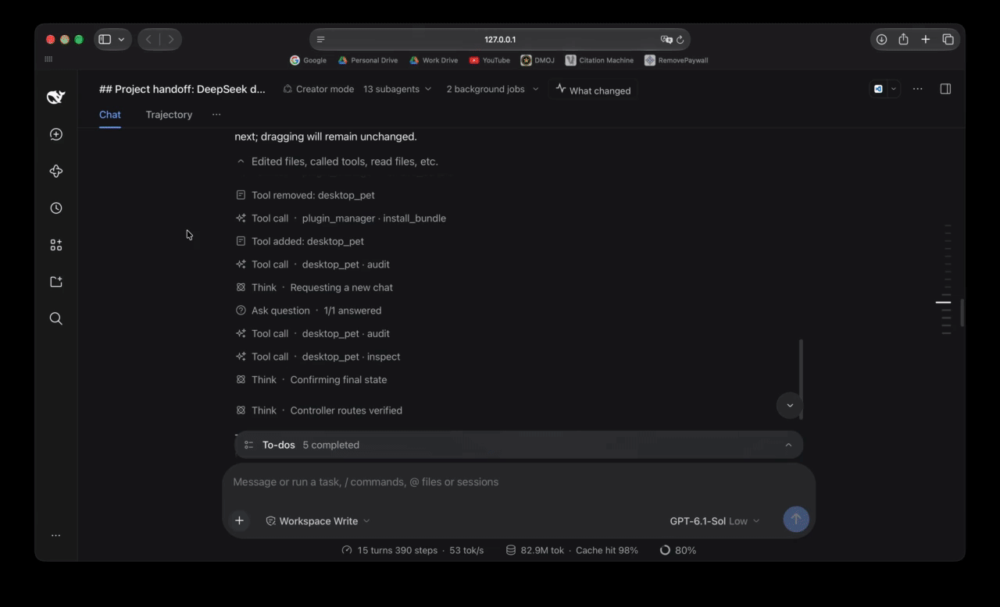

<p align="center"></p>

<div align="center">

# DSH Agent Pulse

**English** · [简体中文](README.zh-CN.md)

**See what your coding agents changed, with evidence behind the summary.**

A native [DeepSeek Harness (DSH)](https://github.com/deepseek-ai/deepseek-harness) sidebar that turns agent activity into behavior-change summaries, observed test results, and sensitive-file access alerts.

[Demo](#demo) · [How it works](#how-it-works) · [Quick start](#quick-start) · [Reference](docs/REFERENCE.md) · [Privacy](#privacy-and-limits) · [Development](#development)

</div>

## Why Agent Pulse?

When several coding agents are working, tool logs show what ran. Understanding what changed—and whether it was checked—takes more digging.

Agent Pulse brings the current session and observed local subagents into one feed. It groups changes by agent turn, adds optional AI explanations of behavior changes, and keeps verification separate from the model's interpretation. Routine reads and web searches stay quiet.

## Demo



_From 13 subagents to a readable outcome summary, then into the recorded code changes. Verification gaps stay visible._

## What you can see

| Question                 | What the feed shows                                                                 |
| ------------------------ | ----------------------------------------------------------------------------------- |
| What changed?            | Turn-based cards with optional AI explanations of behavior changes.                 |
| Was it tested?           | Observed test counts, partial verification, and results made stale by later edits.  |
| What needs attention?    | Failed modifications, observed test failures, and recognized sensitive-file access. |
| Where is the evidence?   | Changed-file links open DSH's native **Review · turn N**.                           |
| What if the model fails? | Factual cards remain available; AI summaries can also be turned off.                |

## How it works

1. **Collect recorded evidence.** DSH events feed a replayable projection of changes, recognized test results, and direct sensitive-file access. Recorded workspace comparisons can supplement direct edits; uncertain concurrent-agent attribution stays explicit.
2. **Explain behavior changes.** At turn checkpoints, an optional model receives bounded, redacted change excerpts and task context. Accepted change-based summaries must reference supplied change IDs. Reference validation does not prove every narrative claim is correct.
3. **Keep verification independent.** Test counts and verification labels come from observed execution evidence, not AI text. A successful exit alone does not establish passing tests; later edits can make earlier results stale.
4. **Keep evidence available.** Missing models, rejected summaries, and provider failures leave factual cards intact. Clicking a changed file opens its recorded native Review rather than comparing against today's files.

The implementation separates evidence projection ([engine.js](engine.js)), summary scheduling ([coordinator.js](coordinator.js)), and the sidebar ([client.js](client.js)). See the [development guide](docs/DEVELOPMENT.md) for the full module map.

## Quick start

### Requirements

- **DSH `0.2.1-rc.2` or newer**, with the Web GUI. This is the declared minimum, not a claim that every later version has been tested. Follow the [official DSH instructions](https://github.com/deepseek-ai/deepseek-harness#run).
- A working DSH plugin manager and the package-manager/Git tooling required by your DSH installation.
- A provider configured in DSH for optional AI summaries. Factual cards do not require a summary model.

### Install from GitHub

In your existing DSH instance, ask its agent:

```text
Install the DSH plugin bundle from
https://github.com/AlanWYChen/dsh-agent-pulse
using plugin_manager → install_bundle.
```

Review DSH's installation prompt and follow any restart instructions. Installation applies to the current DSH profile, not just this conversation.

DSH's [plugin manager supports Git sources](https://github.com/deepseek-ai/deepseek-harness/blob/master/packages/boot/plugin-manager/README.md). This bundle is not published to npm; npm publication is not required for Git installation. A fresh GitHub installation of this plugin has not yet been verified end to end.

For a local checkout and development installation, see the [development guide](docs/DEVELOPMENT.md#install-a-local-checkout).

### Open the feed

1. Follow any DSH restart prompt, then refresh the existing page.
2. Open **What changed** from the conversation header or right-sidebar guide.
3. In **Settings → Summaries**, choose a model or **Off** for factual cards only.
4. Expand **Changes** and click a file to inspect its native Review.

**Summaries are enabled by default and initially follow each originating agent's model. They can incur provider usage and send bounded, redacted code excerpts to that provider.** Choose **Off** to disable model requests. Turning summaries off does not stop local evidence collection or caching.

Model effort, path rules, agent tools, update/uninstall instructions, and runtime reload details are in the [feature and configuration reference](docs/REFERENCE.md).

## Privacy and limits

- **AI summaries send code excerpts to your selected provider.** Inputs are bounded and redacted, not metadata-only. Choose **Off** if those excerpts must not leave your machine.
- Plugin storage includes sanitized metadata, validated narratives, and bounded, redacted whole-file snapshots captured from successful authorized edit/write results. Sensitive paths are excluded; no extra filesystem reads are made for snapshot capture.
- Secret filtering is **best-effort**, not a guarantee. Native Review is DSH's own viewer and may show unredacted source under DSH's normal access rules.
- This is an **activity feed, not a security audit or enforcement system**. Shell reads, MCP operations, nested PTC dispatches, remote agents, external processes, and background tests do not have complete semantic coverage. An empty feed is not proof that no sensitive access occurred.
- Test results describe observed commands, not exhaustive coverage or correctness. Historical sessions must be loaded/observed; the feed is not an exhaustive history scan.
- The plugin cannot approve tools, weaken permissions, or modify project files. Aggregated-feed RPC access is restricted to authenticated profile-owner callers.

Turning summaries off does not stop local evidence collection or caching. Clicking native Review does not send additional code to the summary model. Main controls are bilingual; some deterministic evidence labels and fallback narratives remain English.

See [Privacy and evidence boundaries](docs/PRIVACY.md) for redaction, retention, capture limits, and verification caveats.

## Development

```sh
npm ci --ignore-scripts
npm test
npm run check
npm run format:check
```

Use `npm run format` to apply the repository's Prettier rules. See [Development guide](docs/DEVELOPMENT.md) for the implementation map and local reload notes.

GitHub Actions runs unit/integration tests on Linux, macOS, and Windows with Node.js 22/24, clean-package installation checks, and public-contract smoke tests against minimum/latest DSH. See [CI checks](docs/CI.md) for the exact checks, limitations, and local commands.

## License

[MIT](LICENSE). The plugin icon is original artwork. The working-state whale tail is adapted from DSH; its existing attribution is preserved in [Third-party notices](THIRD-PARTY-NOTICES.md).
