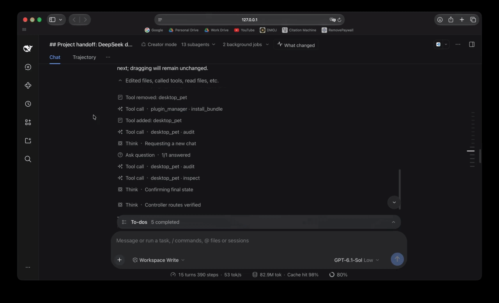

<p align="center"></p>

<div align="center">

# DSH Agent Pulse

[English](README.md) · **简体中文**

**看清编程智能体改了什么，并查看摘要背后的证据。**

为 [DeepSeek Harness（DSH）](https://github.com/deepseek-ai/deepseek-harness) 提供原生右侧栏，将智能体活动汇总为行为变化摘要、实际观察到的测试结果和敏感文件访问提醒。

[演示](#演示) · [工作原理](#工作原理) · [快速开始](#快速开始) · [功能参考](docs/REFERENCE.zh-CN.md) · [隐私](#隐私与边界) · [开发](#开发)

</div>

## 为什么使用 Agent Pulse？

多个编程智能体同时工作时，工具日志能告诉你执行了什么，但要弄清改了什么、是否经过验证，仍需逐一翻阅。

Agent Pulse 将当前会话和已观察到的本地子智能体汇总到同一信息流。变更按智能体轮次归组，可选 AI 摘要解释行为变化，验证状态独立于模型解释。普通读取和联网搜索不会刷屏。

## 演示



_从 13 个子智能体到可读的结果摘要，再进入有记录的代码变更；验证缺口始终可见。_

## 能看到什么？

| 问题             | 信息流展示什么                                                           |
| ---------------- | ------------------------------------------------------------------------ |
| 改了什么？       | 按轮次汇总的卡片，可选 AI 摘要解释行为变化。                             |
| 测试了吗？       | 实际观察到的测试运行、独立检查区、部分验证，以及后续编辑导致的验证过期。 |
| 子任务呢？       | 子智能体的工作归入所属卡片内折叠的“子任务”区。                           |
| 什么需要关注？   | 失败的修改、观察到的测试失败与已识别的敏感文件访问。                     |
| 证据在哪里？     | 点击变更文件，打开原生 **Review · turn N**，包括匹配的子卡片 Review。    |
| 模型失败怎么办？ | 事实卡片仍然可用，也可关闭 AI 摘要。                                     |

## 工作原理

1. **收集已有证据。** 将 DSH 事件投影为可重放的变更、已识别测试结果和直接敏感文件访问记录。有记录的工作区对比可补充直接编辑；并发智能体导致的归属不确定性会明确保留。
2. **解释行为变化。** 在轮次检查点，可选模型接收有界、脱敏的变更片段与任务上下文。基于变更的摘要须引用提供的变更 ID；引用校验不代表每项叙述都正确。
3. **独立记录验证。** 测试数量与验证标签来自实际执行证据，不由 AI 文本决定；检查运行单独记录，不会证明变更已通过测试。成功退出本身不证明测试通过，后续编辑可能使先前结果过期。
4. **始终保留证据。** 缺少模型、摘要被拒绝或服务商请求失败时，事实卡片仍可查看。点击文件优先打开对应的原生 Review；不可用时（包括子智能体编辑），打开明确标注的已记录历史差异，而不是拿当前文件冒充历史版本。

实现分别由 [src/engine.js](src/engine.js) 负责证据投影、[src/coordinator.js](src/coordinator.js) 负责摘要调度、[src/client.js](src/client.js) 负责侧栏。完整模块索引见[开发指南（英文）](docs/DEVELOPMENT.md)。

### 测试、检查与子任务

- **测试运行**按卡片保存在折叠区中，按命令名称而不是执行 ID 展示；有解析结果时显示通过/失败/跳过数量。有变更但没有识别到测试运行时，会明确显示 `Test runs (0)` 缺口。
- **检查**与测试分开记录，且永远不会证明变更通过。`npm run check` / `lint` / `typecheck` / `format:check`、`prettier --check`、`tsc --noEmit`、`eslint` 和 `node --check` 会出现在折叠的 **检查** 区。
- **管道命令**在测试或检查位于管道第一个组件时仍会被记录，因此 `npm test 2>&1 | tail` 不再看起来像没有运行；但管道结果不会验证变更，因为退出码属于过滤命令。
- **子任务**归入所属卡片内、位于测试运行与变更之间的折叠 **子任务** 区。精确委派证据优先；否则根据已观察到的会话关系与时间戳，将子卡片放到最近的父结果卡片下。被复用的子智能体会跟随后续父任务。
- **委派证据**使用已接受的委派调用、实时消息回执与精确的子输入 ID。子结果已经可见时不再重复空后续行；已送达但没有匹配结果的后续会显示 **等待子任务证据**。父卡片中的文件标签会解析到匹配子卡片的 Review。
- **覆盖边界**：支持 Node、Jest/Vitest、pytest、.NET、Maven 与 Gradle 的直接测试命令，以及上述检查和顶层 `&&`/受支持管道；自定义包装器、其他复合 shell 形式与自动发现 XML 报告仍不支持。捕获输出有上限并会被淘汰。

## 快速开始

### 环境要求

- **DSH `0.2.1-rc.2` 或更新版本**，使用 Web GUI。这是声明的最低版本，并不代表所有后续版本均已测试。安装方式见 [DSH 官方说明](https://github.com/deepseek-ai/deepseek-harness#run)。
- 可用的 DSH 插件管理器，以及 DSH 安装所需的包管理器和 Git 工具。
- 如需可选 AI 摘要，请在 DSH 配置模型服务商；事实卡片不需要摘要模型。

### 从 GitHub 安装

在现有 DSH 实例中向智能体发送：

```text
请使用 plugin_manager → install_bundle 安装以下 GitHub 仓库中的 DSH 插件包：
https://github.com/AlanWYChen/dsh-agent-pulse
```

查看 DSH 的安装确认提示，并按需重启。安装影响当前 DSH profile，不只影响这一段对话。

DSH 的[插件管理器支持 Git 来源](https://github.com/deepseek-ai/deepseek-harness/blob/master/packages/boot/plugin-manager/README.md)。本插件尚未发布到 npm，但 Git 安装不要求 npm 发布。目前尚未完成本插件全新 GitHub 安装的端到端验证。

本地源码与开发安装方式见[开发指南（英文）](docs/DEVELOPMENT.md#install-a-local-checkout)。

### 打开信息流

1. 如 DSH 提示重启，请按提示操作，再刷新现有页面。
2. 从会话顶部或右侧栏入口打开 **变更与关注 / What changed**。
3. 在 **设置 → 摘要** 选择模型，或选择 **关闭 — 仅显示事实**。
4. 展开 **测试运行**、**检查** 或 **子任务** 查看证据，展开 **变更 / Changes** 点击文件打开原生 Review。

**摘要默认开启并跟随各来源智能体的模型，会向服务商发送有界、脱敏的代码片段，可能产生用量费用。** 选择关闭可停止模型请求，但不会停止本地证据收集与缓存。

模型推理强度、路径规则、智能体工具、更新/卸载与运行时重载细节见[功能与配置参考](docs/REFERENCE.zh-CN.md)。

## 故障排查

### “变更与关注”为空

该面板按会话独立。权威历史位于 `~/.dsh/sessions/`，侧栏投影与缓存位于 `~/.dsh/storages/agent_activity_intelligence/cache/`。刷新页面只会重新加载浏览器客户端；修改或重装 Host 代码后，需要重启现有的 DSH 进程，让投影重放会话日志。不要随意删除缓存目录，摘要和已捕获的产物不一定能重建。

## 隐私与边界

- **AI 摘要会将代码片段发送给所选服务商。** 输入经过限量和脱敏，并非只有元数据。如果代码片段不能离开本机，请关闭摘要；关闭不会停止本地证据收集与缓存。
- 插件存储包含脱敏元数据、已校验叙述，以及从成功且已获授权的 edit/write 结果捕获的有界、脱敏整文件快照。敏感路径被排除，不为快照额外读取文件系统。
- 秘密过滤是**尽力而为，不是保密保证**。原生 Review 属于 DSH 自身，遵循 DSH 正常权限，可能显示未脱敏源码；点击 Review 不会额外向摘要模型发送代码。
- 这是**活动信息流，不是安全审计或权限执行系统**。shell 读取、MCP、嵌套 PTC、远程智能体、外部进程和后台测试不具备完整语义覆盖。空白信息流不等于没有敏感访问。
- 测试与检查结果仅说明观察到哪些命令执行过，不保证覆盖完整或功能正确。历史会话需要被加载/观察，不会穷尽扫描全部历史。
- 插件不能批准工具、放宽权限或修改项目文件。聚合信息流 RPC 仅供已认证的 profile 所有者调用。

详细的脱敏、保留、捕获上限与验证边界见 [隐私与证据说明（英文）](docs/PRIVACY.md)。

## 开发

```sh
npm ci --ignore-scripts
npm test
npm run check
npm run format:check
```

使用 `npm run format` 按仓库 Prettier 规则统一格式。实现模块索引和本地重载说明见 [开发指南（英文）](docs/DEVELOPMENT.md)。

GitHub Actions 会在 Linux、macOS 和 Windows 的 Node.js 22/24 上运行单元及集成测试，检查干净环境中的包安装，并对最低版本及 latest DSH 进行公共接口契约冒烟测试。具体检查、边界和本地运行方式见 [CI 检查说明（英文）](docs/CI.md)。

## 许可证

采用 [MIT 许可证](LICENSE)。插件图标为原创；工作状态鲸尾改编自 DSH，原有版权声明保留在 [第三方声明](THIRD-PARTY-NOTICES.md) 中。
